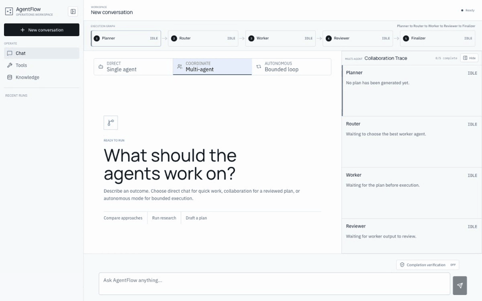
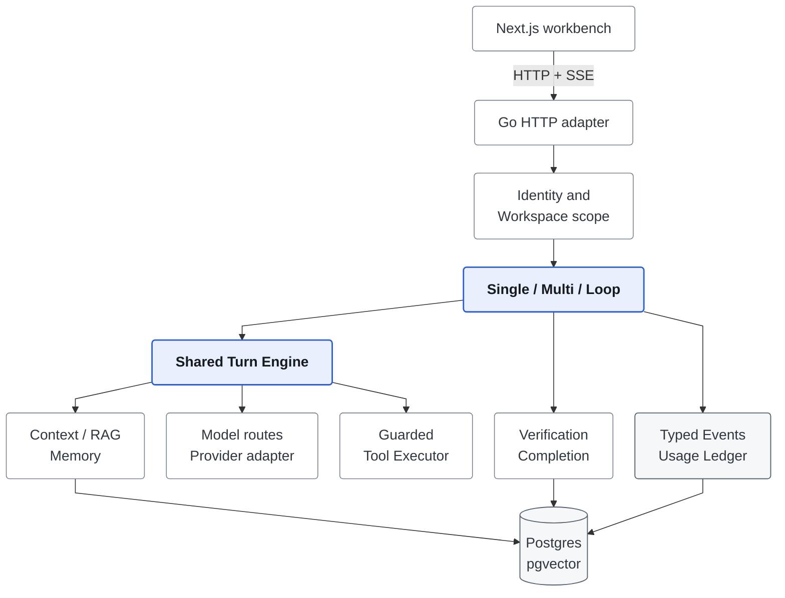

# AgentFlow Platform

[](https://github.com/hoiyd/agentflow-platform/actions/workflows/ci.yml)
[](https://app.codecov.io/gh/hoiyd/agentflow-platform)

**A Go Agent Runtime with a Next.js workbench for inspecting execution, cost,
failures, and recovery.** Single, Multi-Agent, and bounded Loop share one Turn
Engine rather than separate chat implementations.

[Five-minute demo](docs/guides/demo.md) | [Architecture](docs/architecture/backend-architecture.md) | [Design decisions](docs/architecture/engineering-decisions.md) | [Documentation](docs/README.md)

## Demo Gallery



Follow an incident task through plan approval, specialist routing, execution,
review, and Replay. [RAG and Verification recordings](docs/guides/demo.md#recorded-assets)
show the supporting evidence. Recordings demonstrate behavior, not model quality
or performance benchmarks.

## Engineering Highlights

| Problem | Design | Inspect it |
| --- | --- | --- |
| Modes drift into separate implementations | One Turn Engine, guarded Tool loop, and completion path; modes own orchestration | [Execution modes](docs/runtime/execution-modes.md), [Turn Engine](apps/api/internal/agent/turn) |
| A retry or Resume repeats work under changed settings | Frozen Runtime Snapshot, Stage checkpoints, committed Tool receipts, explicit reconciliation of uncertain effects | [Recovery](docs/runtime/durable-recovery.md), [Tool reconciliation](docs/tools/tool-side-effect-reconciliation.md) |
| Agent calls amplify cost and context | Separate Run admission, physical-request limits, cumulative Usage Ledger, and per-call Context capacity | [Control map](docs/runtime/execution-controls.md), [Budget code](apps/api/internal/budget) |
| Retrieval returns plausible but unrelated sources | Independent Semantic/Keyword recall, RRF, pluggable reranking, relevance gating, bounded expansion, and selected-source citations | [RAG pipeline](docs/knowledge/knowledge-rag.md), [Pipeline code](apps/api/internal/rag/retrieval.go) |
| Generated text is mistaken for a completed task | Optional Completion Contract, immutable Verification Evidence, and evidence-backed structured results | [Verification](docs/runtime/verification.md), [Structured output](docs/runtime/structured-output.md) |
| A successful trace is mistaken for quality | Versioned Golden Datasets, controlled comparisons, failure cases, and separately identified live reports | [Evaluation](docs/evaluation/README.md) |

Tools are callable capabilities; Skills are trusted, versioned instructions
loaded progressively. Skills cannot grant themselves Tool or credential access.
See [Tool security](docs/tools/tool-security-policy.md), [Workspace MCP connections](docs/tools/mcp-adapter.md), and [Skills](docs/tools/trusted-skills.md).

## Architecture



Go owns orchestration and governance; OpenAI-compatible services own inference.
Postgres + pgvector is the only application persistence backend. The
[backend guide](docs/architecture/backend-architecture.md) links the code paths
and explains dependency ownership.

## Quick Start

Requires **Go 1.26.5 through gvm, Node.js 22+, PostgreSQL + pgvector**, and a
configured OpenAI-compatible Chat route. From the repository root:

```bash
test -f apps/api/.env || cp apps/api/.env.example apps/api/.env
test -f apps/api/config/model-routes.json || cp apps/api/config/model-routes.example.json apps/api/config/model-routes.json
# Set DATABASE_URL, model routes, and their credential variables before starting.
make quickstart
```

Open [localhost:3000/workspace](http://localhost:3000/workspace). The launcher
starts API/web, not Postgres or a model server. Invalid database/routes/credentials
fail startup; there is no silent simulated-answer fallback. Ctrl+C stops both.
Use `make dev` next time. [Local setup](docs/guides/local-setup.md) covers ports,
embeddings, authentication, and manual startup.

## Reproduce the Evidence

```bash
make benchmark-evidence          # Deterministic retrieval, Tool, and recovery pack
DEMO_MODE=offline make demo-check # Check that pack without an application/model
make test                        # Go, frontend lint/tests, production build
make contract-check              # Regenerate shared API types and reject drift
```

Offline evidence needs installed dependencies but no model key. It proves
regression contracts, not live-model quality. Database acceptance needs a dedicated
`TEST_DATABASE_URL`; skipped Postgres tests are not persistence evidence.
[Evaluation](docs/evaluation/README.md) separates fixture, live, load, and recovery checks.

## Status and Limits

| Status | Scope |
| --- | --- |
| Implemented | Three execution modes; guarded Tools/Skills and opt-in read-only MCP; hybrid RAG and metadata filtering; Context/Memory/Task State; budgets; typed Replay; checkpoints; optional Verification/structured output; optional OIDC and owner-scoped Workspaces |
| Partial / bounded | Recovery is single-instance; evaluation covers frozen tasks, not general quality; injection and grounded-answer checks do not prove semantic truth; sandbox commands are opt-in scratch execution, not arbitrary host access |
| Planned | Durable multi-worker dispatch/lease/fencing, team/object-sharing ACLs, broader retention and release hardening, calibrated model/human graders |

Default local mode is **unauthenticated** and intended for trusted use. Browser
disconnect does not cancel admitted work. Process crashes require lifecycle
repair and explicit Resume; uncertain external effects require reconciliation,
not an exactly-once claim. A RAG `no_match` removes evidence, but unsupported
answers are gated only when the Run opts into the grounded-answer contract.
See [deployment boundaries](docs/operations/production-readiness-roadmap.md).
