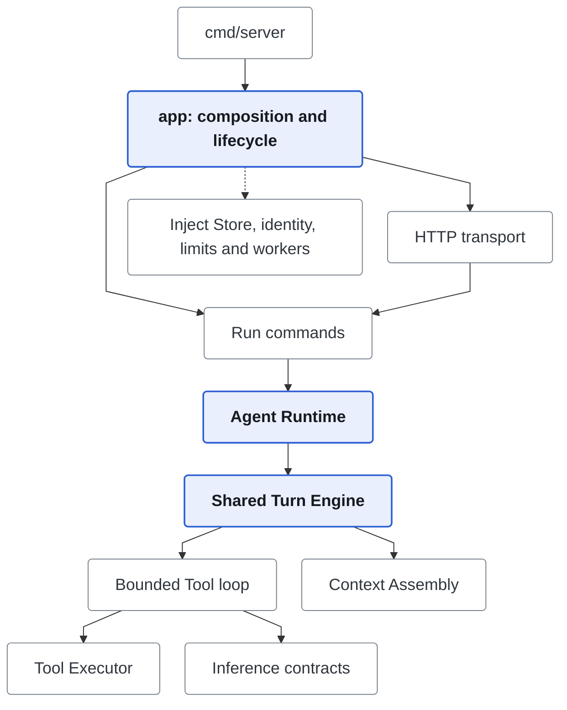
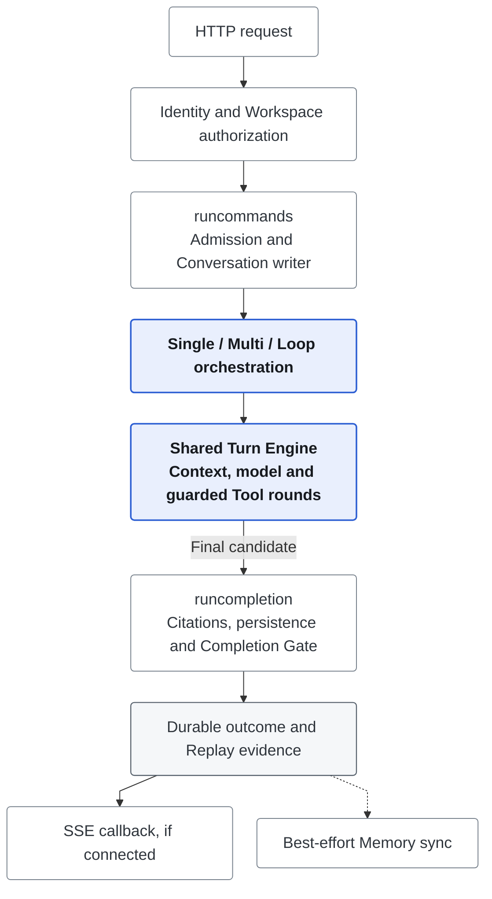
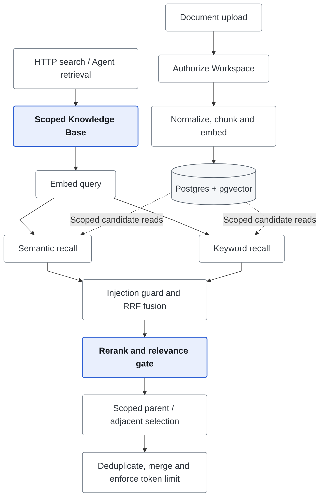

# Backend Architecture

The backend is a Go Runtime with one composition root and one shared Turn Engine.
Modes choose orchestration; they do not implement separate Tool, RAG, accounting,
or completion stacks. [Design decisions](engineering-decisions.md) explains the
trade-offs; [terms](terms.md) defines Run, Stage, Turn, and Snapshot.

## Architectural Invariants

- `cmd/server` handles process startup; `app` constructs production dependencies.
- HTTP owns parsing, SSE, and status mapping, not orchestration or retrieval policy.
- Consumers depend on narrow capability interfaces; Store adapters own persistence.
- Authorized Workspace scope reaches object reads, retrieval expansion and writes.
  HTTP receives a scoped `WorkspaceStore`, not an unscoped Store.
- Frozen protocol defines Resume; current identity, grants and deployment policy
  still apply. Old Snapshot schemas are Replay-only.
- Typed Events describe execution. The Usage Ledger, not Trace totals, owns accounting.

## Package Layout

| Responsibility | Code entry point |
| --- | --- |
| Composition, lifecycle and dependency injection | [`app/`](../../apps/api/app), [`cmd/server/`](../../apps/api/cmd/server) |
| Start/Continue/Resume and final completion | [`app/runcommands/`](../../apps/api/app/runcommands), [`app/runcompletion/`](../../apps/api/app/runcompletion) |
| HTTP/SSE and scoped service interfaces | [`internal/httpapi/`](../../apps/api/internal/httpapi) |
| Mode orchestration, Turn Engine, model/Tool rounds | [`agent/`](../../apps/api/internal/agent), [`agent/turn/`](../../apps/api/internal/agent/turn), [`agent/toolloop/`](../../apps/api/internal/agent/toolloop) |
| Provider-neutral contracts, routing, request controls, Capture | [`inference/`](../../apps/api/internal/inference) |
| Catalog, Executor, policy, results, progress, reconciliation | [`tool/`](../../apps/api/internal/tool), [`skill/`](../../apps/api/internal/skill) |
| Input capacity and non-destructive summaries | [`contextassembly/`](../../apps/api/internal/contextassembly), [`contextcompaction/`](../../apps/api/internal/contextcompaction) |
| Ingestion, shared retrieval policy and curated Memory | [`knowledge/`](../../apps/api/internal/knowledge), [`rag/`](../../apps/api/internal/rag), [`memory/`](../../apps/api/internal/memory) |
| Admission, cumulative accounting, durable task facts | [`concurrency/`](../../apps/api/internal/concurrency), [`budget/`](../../apps/api/internal/budget), [`taskstate/`](../../apps/api/internal/taskstate) |
| Durable contracts, events, failures, SQL | [`domain/`](../../apps/api/internal/domain), [`event/`](../../apps/api/internal/event), [`failure/`](../../apps/api/internal/failure), [`store/`](../../apps/api/internal/store) |
| Recovery and Stage checkpoint validation | [`recovery/`](../../apps/api/internal/recovery), [`checkpoint/`](../../apps/api/internal/checkpoint) |
| Isolated evaluation and evidence reports | [`evaluation/`](../../apps/api/internal/evaluation) |

`internal` is Go's module-private boundary, not a generic architectural layer.
Packages are grouped by responsibility rather than mirrored `core/services` folders.

## Dependency Direction

`agent.NewRuntime(RuntimeOptions)` requires its execution dependencies explicitly,
including checkpoint provider, routes, embedding client and Tool manager. Missing
required capabilities are construction errors, not inferred Store methods or
post-construction setters. `app` installs Task State, Artifact and Knowledge bindings.

The provider adapter sends individual requests; it cannot create a Tool Executor
or redefine persistence, authorization or completion. Skills enter through the
existing Context and Tool paths, not a second permission or workflow system.

## Main Call Paths

### Chat and Completion

Admission observes caller cancellation. Once admitted, execution is detached
from browser delivery; explicit Stop cancels the Runtime. Writer/capacity release
precedes queued follow-up dispatch. See [durable inputs](../runtime/durable-inputs.md).
The Turn node expands into the [shared model/Tool loop](../tools/bounded-tool-loop.md).

### Retrieval and Ingestion

The pipeline owns ranking and relevance; Store owns predicates and candidate
reads. Ranked child hits remain separate from model `context_items`. Expansion
cannot widen Workspace, document or metadata scope. See [RAG](../knowledge/knowledge-rag.md).

## Application Lifecycle

`app.Application` opens Postgres, repairs stale lifecycles, constructs services
and starts HTTP. Shutdown drains accepted Runs, then Memory work, then closes
Store. A timed-out drain leaves Store open rather than closing it underneath work.
Checkpoints and [recovery](../runtime/durable-recovery.md) preserve explicit failure
state; they do not provide distributed dispatch or automatic cross-process takeover.

## Extension Points

| Change | Boundary and required evidence |
| --- | --- |
| Model provider | Adapter below the existing provider contract; serialized continuation/stream tests |
| Tool | Descriptor + Binding in the existing Catalog/Executor; schema, authority, side-effect and recovery contracts agree |
| Reranker | `rag.Reranker`; version/config identity and score validation; relevance policy remains in `RelevanceGate` |
| Verifier | Versioned registry implementation owning config normalization and Evidence |
| Persistence adapter | Consumer capability interfaces; scoped queries, migration and round-trip evidence |
| Failure type | Subsystem error implementing `failure.Classified`; safe public details and original cause in logs |

Use the composition root for new executables rather than copying construction.
Add an abstraction only when it removes real duplication or separates ownership,
lifecycle or failure behavior. [Control ownership](../runtime/execution-controls.md)
and [API workflow](api-contract.md) cover cross-layer changes.
