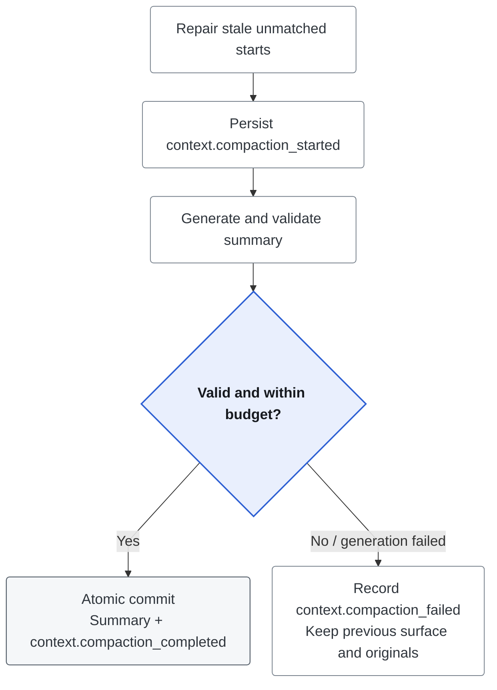

# Context Assembly and Compaction

Context Assembly makes **one logical Model Call** fit its input capacity. It is
not cumulative cost accounting; [Run Budget](../runtime/run-budget.md) owns that.

```text
input capacity = model context window - output reserve - safety margin
```

The Context Manifest explains selected/excluded sources, transformations and
estimates without copying raw dynamic content. Compaction creates an immutable
summary of older Messages; originals remain authoritative and recoverable.

## Selection Contract

| Source | Treatment |
| --- | --- |
| System protocol, current input, Tool protocol and active results | Required; oversized results use a separate bounded transformation |
| Task State | Required when a Revision exists; reloaded for every logical assembly |
| [Project instructions](project-instructions.md) | Explicitly trusted, path-selected and frozen; required, deduplicated and bounded |
| Active persisted summary | Required; covered raw Messages are shadowed, not deleted |
| Recent history, curated Memory, RAG | Selected within source and total budgets |
| Retrieved original session sources | Bounded exact evidence, separate from the recent raw tail |

Required content that cannot fit fails the call; optional overflow receives an
exclusion reason. RAG aliases such as `S1` remain eligible for citations only if
their sources survive this final packing check.

### Complete Message Protocol

The assembler uses `provider.Message`, including Tool Calls, `reasoning_content`
and `refusal`. Non-display continuation fields count toward capacity; absent and
explicitly empty reasoning stay distinct. Assembly copies mutable protocol data;
trace filtering must never mutate the outgoing request. `Source`/`ReferenceID`
are provenance metadata, not wire fields. Supported provider boundaries are in
[Tool-loop protocol](../tools/bounded-tool-loop.md).

Recalled Memory is JSON-wrapped under the versioned `recalled-memory-trust-v1`
policy and cannot override system instructions, current input, Task State or Tool
authority. Task State is bounded JSON referenced by immutable Revision. Historical
sources are read-only evidence, not new instructions. See [Memory](memory-management.md)
and [Task State](../runtime/task-state.md).

The Manifest records source references, selection reasons, transformations,
estimated tokens and a stable prefix hash. The separate
[Request Envelope / Capture](model-request-reconstruction.md) hashes each final
physical request and governs optional content retention. The Manifest does not
authorize retaining prompts or reasoning.

## Session History Retrieval

At non-isolated Turn entry, bounded keyword retrieval searches durable Messages
and evidence-bearing Events for older IDs, errors, commands and nearby context.
It excludes active raw Messages and Events from the current Run to avoid recursive
trace matches. Internal callers can also filter by Message/Event ID, type, role
and inclusive time range.

Recovered sources keep `message:<id>` / `event:<id>` references and do not change
the Session Log. Search limits are frozen with the Run. Search is best effort:
`session_history.search_started/completed/failed` records counts/references, not
raw text; Store failure does not block the answer call. Arbitrary Event types
are available to explicit queries, not automatically searched by keyword.

## When Compaction Runs

| Trigger | Behavior |
| --- | --- |
| Soft | Asynchronous after a completed Run; uses highest observed prompt usage when available, otherwise local estimates |
| Hard | Best-effort preflight at non-isolated Turn entry; later Tool follow-ups reassemble input but do not rerun history search/compaction per attempt |
| Provider overflow | One forced recovery for text-only `context_length_exceeded`, only if the persisted generation advances |

Trigger defaults and configuration are in [`.env.example`](../../apps/api/.env.example).
Compaction skips when off or fewer than two new Messages are eligible. Isolated
Worker Turns skip conversation compaction/history retrieval. Agent streams that
may have executed Tools are never automatically replayed after overflow.

## Compaction Algorithm

`context-compaction-v4` incrementally summarizes previous summary plus eligible
older Messages. It preserves source evidence while excluding generated current
plans: task lifecycle belongs to Task State, not a second model-written plan.

### Selection Algorithm

```text
estimated_surface = tokens(previous_summary) + tokens(uncovered_messages)
trigger_tokens = max(estimated_surface, available_provider_prompt_tokens)
threshold = input_capacity * configured_soft_or_hard_ratio
```

Provider usage may include Tools/Memory/RAG; the local surface estimate covers
only Conversation history/summary. A forced overflow trigger bypasses the ratio.

1. Exclude the previous generation's cumulative `source_message_ids` from the
   active surface, retaining originals in Store.
2. Group each user Message with following assistant/Tool protocol until the next
   user Message; never split a protocol group.
3. Protect complete newest groups: at least four Messages, then the configured
   recent-token target. A whole group can exceed that target.
4. Summarize the remaining older Messages only when at least two are newly eligible.
5. Persist cumulative ordered source IDs and a hash of source ID/role/content
   tuples for lineage and idempotency.

### Dynamic Summary Budget

For a summary cap of at least 256 tokens, target
`clamp(eligible_source_tokens / 5, 256, summary_max_tokens)`; a smaller cap is
the target itself. Background prose may be clipped, but evidence JSON may not.
The summarizer uses the originating Run's Chat model, not the embedding service.

A new summary starts with `## Source Evidence` and an unfenced JSON array:

```json
[{"message_id":"original-message-id","role":"user","quote":"Cancel the delivery task."}]
```

Before commit, each declared source must belong to the Conversation and cumulative
selected set, with the original role and verbatim quote. Foreign/protected-tail
Messages, malformed evidence and over-budget evidence reject the candidate;
JSON is re-encoded to remove ambiguous duplicate keys. `[]` is valid when no
important evidence is declared. This validates attribution, not completeness.

Only four optional sections may follow: `Established Facts`, `Superseded
Instructions`, `Exact References`, `Source References`. Unknown sections/subheadings
and generated plans (`Pending Work`, `Current State`, etc.) fail before clipping
or commit. Current user input and Task State take precedence over the summary.
Legacy summaries remain readable but are not retroactively validated or repaired.

Authority follows the claim: user corrections govern user decisions; assistant
acknowledgments do not prove actions; execution outcomes need Tool evidence.
Prompts preserve unknowns/conflicts without inventing blockers or reopening resolved
decisions. These semantic rules are guidance, not deterministic truth checks.
The structural guard rejects planning sections, not every possible faulty inference.

### Generation and Commit Protocol



Each completed generation records previous ID, cumulative sources, shadowed
boundaries, source hash/count, target, token estimates, ratio, model and algorithm.
Postgres enforces one generation number per Conversation. Only completed generations
can become active. Failures emit `context.compaction_failed` without replacing the
previous surface. Orphan starts close as failed after `max(1 minute, 2 * timeout)`.

### Effectiveness and Retry Guards

Temporary failures/timeouts cool down for one minute; authentication, quota,
validation and missing-model/configuration failures for 15 minutes. Two consecutive
generations below 10% reduction suspend automatic compaction for 30 minutes.
Lifecycle Events retain cooldown state for restart recovery.

Text-only overflow recovery forces compaction once per Turn ID, reloads the
generation and retries only if it advanced. A Tool round does not create a new
overflow guard. Tool side effects forbid automatic stream replay.

### Current Scope

Rolling summaries use persisted Conversation Messages, not Events (`source_event_ids`
is empty). Memory, RAG, Tool schemas and result compaction retain independent
budgets/transformations. Lineage and originals aid debugging; they do not make
lossy summaries semantically lossless.

## Compression Ratio

```text
after_tokens = tokens(stored_summary) + protected_tail_tokens
remaining_ratio = after_tokens / before_tokens
reduction_ratio = 1 - remaining_ratio
compression_factor = before_tokens / after_tokens
```

These are local surface estimates, not provider-measured savings. Complete message
groups, the raw tail and summary cap affect the result; no fixed ratio is promised.
Oversized Tool results instead preserve bounded head/tail content and record
`tool_result_compacted`; that is not LLM conversation compaction.

## Quality Regression

`make context-eval` exercises the production Assembler with fixed summaries:
fact retention, stale exclusion, source shares, prefix stability, overflow and
fallback. It proves assembly contracts, not generated-summary quality. See
[offline gate](../evaluation/offline-evaluation.md#context-quality-gate) and the
separate [live fidelity/continuation experiment](../evaluation/live-compaction.md).

## Failure Semantics

| Failure | Outcome |
| --- | --- |
| Required input cannot fit | Fail before model transport; never drop protocol silently |
| Optional source overflow | Exclude with Manifest reason |
| Wrong source/author/quote or malformed evidence | Reject candidate with classified evidence error; retain originals/previous summary |
| Summary cap would cut evidence | Reject; only background prose may be clipped |
| Generated operational sections | Reject with `context_summary_operational_content`; never mutate Task State |
| Hard compaction fails | Normal recent-history fallback, only if the request still fits |
| Soft compaction fails | Record after completion; do not change the completed Run |
| Crash before atomic commit | Orphan repair; no partial active summary |

Source-boundary integration fixtures cover these failures. Semantic invention or
misinterpretation still requires model-backed evaluation; exact quotations alone
do not prove that the model understood a correction or cancellation.
