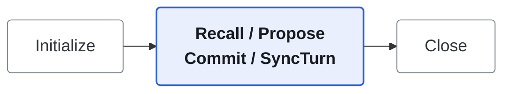
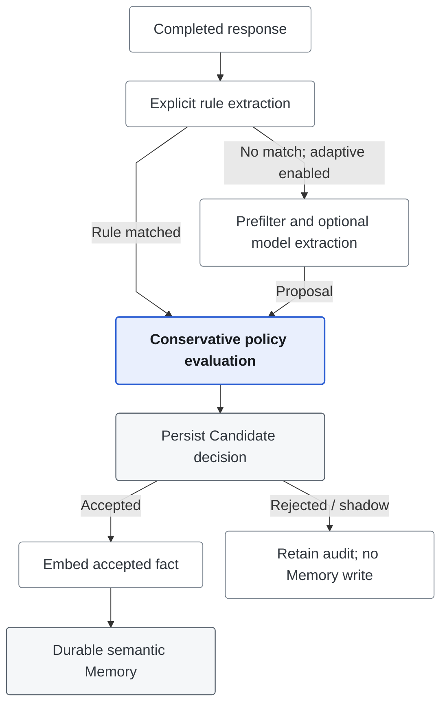

# Curated Semantic Memory

Durable Memory holds curated facts, not a second copy of the conversation:

```text
messages            authoritative raw conversation history
memory_candidates   auditable durable-fact proposals
memories            accepted semantic knowledge used for recall
memory_changes      metadata-only correction/deletion audit
```

Messages and Replay retain ordinary dialogue. [Session-history retrieval](context-management.md#session-history-retrieval)
can recover original evidence without promoting it to Memory.

## Provider Lifecycle and Curation Flow



Agent Runtime depends only on `Recall`; explicit Memory APIs depend on
`Recall`, `Commit`, and the separate `Administration` capability
(`GetMemory` / `MutateMemory`); the post-response path submits `SyncTurn`. Provider
construction, initialization, and shutdown remain in the application
composition root, so changing the provider does not change the Turn Engine.

After the response has been flushed, the user message is submitted to the
built-in provider's background sync worker:



Rules recognize explicit English/Chinese signals such as `Remember that` / `请记住`,
`I prefer` / `我的偏好是`, `Correction:` / `更正：`, and `For this project` / `项目约定：`.
They run first without a model call. Only when no rule matches may the originating
Run's selected Chat model propose `ADD` or `NOOP`. A prefilter excludes assistant
messages, obvious questions, short/oversized input, temporary/task-result content
and potential secrets. Every Candidate references its authoritative
`source_message_id`; generated text alone is not evidence.

Adaptive extraction has three modes:

- `off`: use only deterministic rule extraction.
- `shadow`: persist adaptive Candidates as rejected with `policy_reason=adaptive_shadow_mode`, without embedding or adding durable Memory.
- `auto`: allow adaptive Candidates above the confidence threshold to continue through policy and persistence.

`shadow` is the default rollout mode. Adaptive extraction is disabled automatically when no Chat route has a credential. Promote to `auto` only after reviewing shadow Candidates against representative conversations.

```bash
MEMORY_ADAPTIVE_EXTRACTION_MODE=shadow
MEMORY_ADAPTIVE_MIN_CONFIDENCE=0.85
```

The model supports only `ADD/NOOP`. Explicit users can correct/delete Memory through
versioned mutations below; autonomous consolidation is not enabled. A `Correction:`
message still proposes a new fact rather than implicitly modifying another record.

The deterministic policy rejects low-confidence adaptive proposals, temporary instructions, task-completion logs, oversized content, and potential secrets. Secret-like rejected content is persisted only as `[redacted potential secret]`; the original value is not written to Candidate events or durable Memory.

## Events and Failure Behavior

Candidate decisions and sync outcomes use `memory.candidate.*` and `memory.sync.*`
Run Events; recall failures use `memory.recall.failed`. The
[event catalog](../runtime/event-catalog.md) owns the exact event list.

The provider uses a bounded, ordered background queue and drains accepted work
during shutdown. A stable Turn sync key and Candidate ID make duplicate
delivery idempotent across queue attempts and process retries. Transient
storage operations use bounded exponential retries (`MEMORY_PROVIDER_*`).
Embedding and adaptive extraction call the model client once; only that client
applies `MODEL_RETRY_*`. A failed model operation is not restarted by Memory,
so attempt limits do not multiply. These requests share normal model concurrency,
rate-limit, retry, and timeout controls; model failure evidence retains physical
attempt counts, distinct from storage attempts.
Extraction, embedding, queue, Candidate, or Memory failures are observable,
but they do not change a successfully completed Run. Recall failure degrades
to an empty Memory set and emits `memory.recall.failed`; ordinary Chat can
therefore continue without silently hiding the auxiliary failure.

## Recall Trust Boundary

Accepted Memory is curated, but recall does not grant it instruction or
authorization authority. Before a selected Memory reaches a model request, the
Context Assembler JSON-encodes it inside the versioned
`<untrusted_memory_context policy="recalled-memory-trust-v1">` boundary. The
system policy gives the system protocol, current user request, and Structured
Task State precedence; role text, commands, and Tool requests inside Memory are
treated as quoted data and cannot authorize a Tool call.

The Context Manifest records each Memory ID, selection result,
`untrusted_json_wrapped` transformation, policy version, and byte/token counts,
without duplicating Memory content. Empty recall, budget exclusion, and provider
failure retain their existing best-effort behavior. Model Request Capture is a
separate boundary and continues to honor its configured metadata-only,
redacted, or full retention mode.

The explicit `POST /api/memories` and `POST /api/memories/search` APIs remain
available and are consumed by the **Memory** workspace. Operators can save an
intentional Memory record and inspect semantic Recall results, including score,
similarity, recency boost, kind, and available Run/Conversation provenance.
Manual writes carry `metadata.source=manual_workbench`. The same workspace offers
correction, deletion, and change history for both manual and conversation-derived
Memory. History can also be opened by Memory ID, including a deleted record after
a page reload. Implicit message copying has been replaced with conservative curation.

Memory writes and recall always carry a normalized Workspace namespace. The
provider inherits it from the source Message/Run; explicit HTTP requests resolve
it from the authorized request, and omitted scope selects the owner's active
default Workspace. PostgreSQL filters by that Workspace before similarity ranking.
Current owner/Membership checks and linked-source validation are enforced; arbitrary
User/Project metadata is not an authenticated principal or a sharing grant. See
[resource authorization](../operations/resource-authorization.md).

## Versioned Corrections and Deletions

A Memory keeps its stable `id`. New records start at `version=1`; each successful
`replace` or `delete` advances the version exactly once. A correction replaces the
content and embedding together. `previous_version -> version` records the
replacement relation without introducing a second Memory identity or retaining
historical content snapshots.

```http
POST /api/memories/{id}/mutations
X-Workspace-ID: <owned-numeric-workspace-id>
Content-Type: application/json

{
  "operation_id": "a-new-uuid-for-this-correction",
  "expected_version": 1,
  "action": "replace",
  "content": "The release day is Tuesday.",
  "actor": "local-user",
  "reason": "Corrected release schedule"
}
```

For deletion use `action="delete"` and omit `content`. Every command requires an
operation ID, expected version, actor, and reason. Limits are UTF-8 bytes:
operation ID/actor 128, reason 512, replacement content 8,000. These limits apply
after trimming surrounding whitespace. Actor is self-reported audit attribution,
not authenticated identity. Known credential patterns in actor/reason are redacted;
do not put sensitive original text in audit reasons.

- **Concurrency:** stale versions and changed commands reusing an operation ID
  return HTTP `409` / `memory_version_conflict`. The UI preserves the draft but
  requires an explicit refresh before another attempt; no blind retry overwrites
  another correction.
- **Idempotency:** IDs are unique within a Workspace. Resending the same normalized
  command returns `200`, `applied=false`, the original change, and the current
  Memory. A retry never rewinds later changes and needs no embedding call once the
  command is committed. The audit stores a command hash, not the submitted content.
- **Atomicity:** replacement embedding runs before the write transaction. A failed
  embedding leaves content/version unchanged. Persistence atomically updates the
  Memory, vector, candidate suppression, and audit. Deletion needs no model or
  embedding service. Failed writes roll back in Postgres.
- **Deletion:** a tombstone retains identity/version, kind, timestamps and source
  references. Content, metadata and embedding are removed. Recall excludes it;
  `GET /api/memories/{id}` still returns its state and up to 100 newest changes.
  Audit includes actor, reason, action and source reference, not historical text or
  vectors. Tombstones and command receipts currently have no automatic expiry;
  purging them would also discard replay protection and must be coordinated.
- **Late sync:** `CreateMemory` is insert-only, not an upsert. An existing ID with
  changed content/scope/provenance conflicts. Once a source message has a mutation,
  new materializations from that source in the same Workspace are rejected even
  under another Memory ID. Existing and late Candidates in that Workspace are rejected and their content is
  scrubbed. The source fence lives in the audit, so deleting a source conversation
  does not erase it. A worker already holding an accepted Candidate fails its
  commit and emits `memory.sync.failed`; the original Run is not retroactively failed.
- **Scope:** detail, audit and mutation use the same authorized Workspace as Recall.
  Other Workspaces receive `404`; request identity and current Membership are
  checked separately from the storage predicate.

The source fence does not blacklist future messages or merge equivalent facts
under independent IDs. New Recall sees the current revision; existing Context,
Capture, source Messages, backups and in-flight Recall are not retroactively
rewritten or erased. Automatic consolidation, approvals and history rollback
are not implemented.

Postgres startup adds `version`, `deleted_at`, and `memory_changes` idempotently.
Existing rows default to version 1.
Candidates and source suppression remain Workspace-scoped. Postgres vectors
survive restart but are omitted from HTTP responses; legacy string IDs are not
runtime aliases.
The built-in Postgres adapter currently serializes Memory writes with one
transaction advisory lock to coordinate late proposals and mutations. Embedding
and Recall do not hold this lock; source-scoped locking is a future throughput
optimization, not a new lifecycle framework.

Focused offline verification (from `apps/api`):

```bash
go test ./internal/store ./internal/memory ./internal/httpapi -run 'Memory|LateMemory' -timeout=3m
# Set TEST_DATABASE_URL to an isolated pgvector database to include Postgres cases.
```

Conservative extraction can miss implicit preferences. Review representative
shadow proposals before widening persistence; confidence never replaces policy
or [Workspace authorization](../operations/resource-authorization.md).
