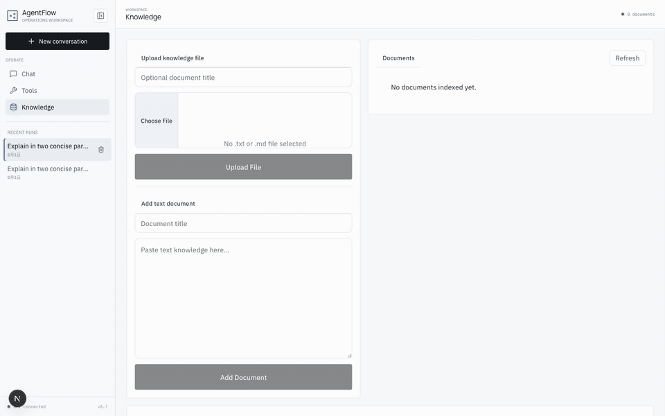
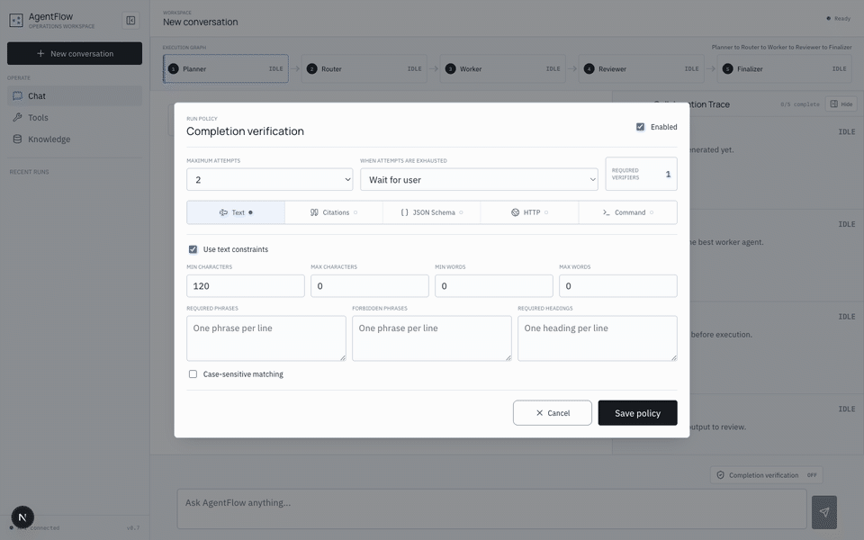

# Five-minute Demo

Show one incident task from request to evidence, not every screen. Preparation
is outside the five minutes; model latency and output quality vary.

## Preparation

1. Follow [Local setup](local-setup.md), then run `make quickstart`.
2. In **Knowledge**, upload [`examples/example.md`](../../examples/example.md).
   Select an Agent with RAG and `get_current_time` enabled; its route must support Tools.
3. In **Verification**, enable Text constraints with one attempt, **Wait for user**,
   and required phrases `AUTH-7F31` and `401 invalid_signature`. This checks a
   response invariant, not the truth of the entire answer.
4. Prepare the deterministic recovery evidence in another terminal:

```bash
make benchmark-evidence
make demo-check
```

The second command checks services and evidence files. Without an application or
model, use `DEMO_MODE=offline make demo-check` after generating the pack. It checks
the pack only; it does not prove that the live application starts. Optional live
benchmark reports are described in [offline/live evaluation](../evaluation/offline-evaluation.md).

## Demo Flow

| Time | Action | Evidence to inspect |
| --- | --- | --- |
| 0:00-0:30 | Open [the workbench](http://localhost:3000/workspace); select Multi | Explain that modes share one Turn Engine, Tool Executor, Context Assembly, and Usage Ledger |
| 0:30-1:30 | Submit the prompt below and approve the plan | Planner/Router/Worker/Reviewer Stages; frozen configuration and selected Agent |
| 1:30-3:00 | Open **View trace** | Selected RAG chunks, model/Tool calls, usage, and Verification Evidence; distinguish Run status from verification status |
| 3:00-4:15 | Inspect the prepared before/after recovery pair | Durable failure, eligible Resume action, resumed Stage and terminal result |
| 4:15-5:00 | Export the **Episode report** and explain limits | One compact review artifact linking output, calls, sources, usage, and failure evidence |

```text
Use the authentication incident runbook to diagnose login failures after a
signing-key rotation. Return the incident code, the observed error, likely cause,
and recovery steps. Use get_current_time to include the current UTC time. If the
runbook is insufficient, say so instead of guessing.
```

A failed verifier is a valid demonstration: inspect why completion was blocked
rather than weakening the contract to make the recording pass. Plain chat has
no Verification gate unless explicitly enabled.

## Recovery Evidence

`make benchmark-evidence` writes these under `.cache/benchmark-suite/`:

| Artifact | What to look for |
| --- | --- |
| `benchmark-recovery-before-replay.json` | `failed_recoverable`, durable evidence and an enabled Resume action |
| `benchmark-recovery-replay.json` | `run.resumed`, checkpoints and terminal `completed` |
| `recovery-paths.jsonl` | HTTP/SSE recovery checks, stale-action and unsafe duplicate rejection |
| `rag-offline.json` | Deterministic retrieval gate, not live-model quality |

These are isolated fixtures, not Runs in your application's database. If a real
recoverable Run is available, use **Needs attention** and its projected Recovery
Action instead. Process-level restart/repair is a separate
[disposable-database drill](../operations/release-recovery-drill.md).

## What This Demonstrates

- **Shared execution:** orchestration changes; Tool, Context, accounting and
  completion contracts stay shared.
- **Auditability:** Snapshot explains configuration, Replay explains execution,
  and Usage Ledger explains accounting. Streaming text is not durable evidence.
- **Recovery:** committed work can be reused only after checkpoint/definition
  checks; uncertain external writes require reconciliation.
- **Measured limits:** fixture passes prove contracts. Quality/cost claims need
  controlled live reports with failures and skipped trials retained.

The supported deployment is trusted and single-instance. Local mode is
unauthenticated; optional OIDC adds identity and owner-scoped access, not complete
team-sharing ACLs or distributed Worker ownership. See
[deployment scope](../operations/production-readiness-roadmap.md).

## Recorded Assets

### Multi-Agent Execution and Replay


### Knowledge and Retrieval



### Completion Verification



Recordings show behavior, not benchmarks. Offline visual references:
[Single](../assets/single-mode.png), [Multi](../assets/multi-mode.png),
[Loop](../assets/loop-mode.png).
