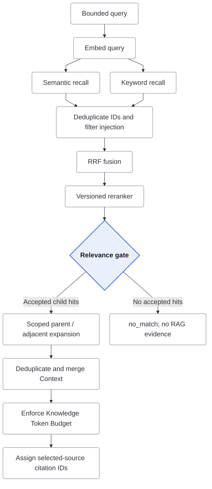

# Knowledge / RAG

HTTP search, Knowledge Tools and all Agent modes share a staged retrieval pipeline.
The design separates **candidate ranking**, **evidence acceptance**, and **model
Context** so each can be inspected and tested independently.



The recall branches are independent candidate sources, not a promise of parallel execution.

For business fields and selection policy, see [metadata schema](metadata-schema.md),
[updates](metadata-updates.md), [document lifecycle](document-lifecycle.md), and
[Runtime Knowledge scope](runtime-knowledge-filters.md).

## Ingestion and Inspection

**Knowledge** accepts text and `.txt`/`.md`/`.markdown` files and exposes documents,
chunks, embedding identity and search diagnostics. Markdown chunking preserves
heading paths, paragraphs/lists/code blocks and language; oversized blocks use
fixed-size splitting. Prepended heading context improves retrieval but is not
part of the original source range.

## Index Lifecycle and Compatibility

`source_key` identifies one logical source inside a Workspace; it defaults to
`source_uri`. Reingestion is idempotent when key/version/content/index identity
match. Same key/version with different content returns `409`. A new version or
index identity atomically replaces active chunks/embeddings while preserving the
Document ID/creation time; failed replacement leaves the old index intact.
Deletion removes the document and dependent chunks/embeddings.

Retrieval checks every active index against the query embedding identity and
chunker version. Unknown/mixed provider/model/dimensions fail with
`knowledge_index_incompatible`, never silently mix vector spaces. Migration can
infer identity only from agreeing legacy data; unknown identity stays unusable.

## Chunk Source Traceability

| Field | Meaning |
| --- | --- |
| `version` | Explicit ingest version, otherwise `sha256:<document_content_hash>` |
| `content_hash` | Lowercase SHA-256 of normalized Document/Chunk content |
| `section_path` | Structured headings; legacy `heading_path` remains available |
| `start_offset`, `end_offset` | Half-open UTF-8 byte range in LF-normalized, outer-trimmed source |
| `parent_id` | Deterministic section identity within a document version; plain text uses the document root |

Offsets exclude prepended retrieval headings. Postgres retains normalized source
for later resolution, but HTTP Document responses omit full source content.
Legacy chunks do not receive invented hashes/offsets. Document detail, search,
Agent events and model traces expose the same source fields.

## Retrieval Pipeline

| Stage | Contract |
| --- | --- |
| Embed | Normalize the bounded query with the configured provider/model |
| Recall | Independent Semantic and Keyword candidates, with Workspace, metadata and lifecycle eligibility before Top-K limits |
| Guard / fuse | Deduplicate IDs, reject high-confidence injection, preserve recall ranks and compute equal-weight RRF |
| Rerank | Order candidates with versioned implementation/configuration identity |
| Gate | Recompute trusted evidence, accept/reject independently of incoming confidence, compact final ranks |
| Context | Expand accepted child hits without widening scope, then deduplicate/merge within Knowledge Token Budget |

Semantic recall uses cosine similarity. Postgres Keyword recall combines exact
substring matching and `simple` full-text search with generated `tsvector`/GIN
indexes. The offline fixture instead uses phrases, identifier terms and term
coverage; it is not BM25 or a measurement of semantic retrieval quality.

```text
rrf_score = sum(1 / (60 + rank_in_recall_path))
```

A missing path contributes zero; chunk ID breaks ties. `fusion` exposes algorithm,
version, rank constant and weights. Raw scores remain observable but are not
compared across recall paths. Reranking starts from normalized RRF with additional
evidence/metadata/diversity signals; RRF does not make `lexical_boost` redundant.

### Reranker and Relevance Gate

`Reranker` returns candidate IDs, scores/ranks and per-request implementation
metadata. The default is `heuristic-reranker-v1` / `heuristic-default-v1`; an
optional [TEI Cross-Encoder](cross-encoder-reranking.md) uses the same pipeline
without silent fallback or a default-policy change. Model-backed scores must be
normalized to `[0,1]`; requested Top-K must be complete and ordered.

`RelevanceGate` ignores incoming confidence/filter decisions and recomputes evidence.
The default `heuristic-relevance-gate-v3` / `heuristic-relevance-hardened-v2`
requires configured `minimum_evidence_coverage` or an exact alphanumeric identifier
before a saturated lexical score alone can qualify as `high`. A score of `1.0`
cannot bypass the evidence policy.

Both stages consume detached inputs and return only fields they own. Unknown or
duplicate IDs, invalid ranks/order, missing metadata and non-finite scores fail
the pipeline. Candidate content, scope and recall evidence cannot be overwritten.
Gate decisions match inputs one-for-one; accepted candidates form an ordered subset.

`relevance_decisions` records identity, recall/ranking signals, matched terms,
coverage, identifier match, confidence and rejection reason without source text.
API/Replay retain the gate configuration and decisions, including empty lists.
UI **Semantic**/**Keyword** labels preserve `vector_rank`, `lexical_rank`,
`dense_weight` and `lexical_weight` wire names.

## Retrieval Query Boundary

HTTP uses `query`; Runtime uses the original Run `user_input`, not a concatenation
of plans, reviews and Stage output. `bounded_subquestion` is reserved for explicit,
traceable subquestions; automatic rewrite is not implemented. Missing/unknown
query source skips retrieval rather than falling back to the whole Stage prompt.

Replay records `query`, `query_source`, `stage_id`, skips and reasons. Memory and
Knowledge share this intent boundary. Regression fixtures compare API/Runtime
ranked hits, selected Context, citations, no-match and embedding failures; saturated
off-topic lexical candidates must also be rejected across Single/Multi/Loop.

## Workspace Boundary

HTTP resolves authorized numeric scope; Runtime inherits persisted Conversation/Run
scope. Store recall and expansion retain Workspace and eligibility predicates;
omission selects the owner's active default, never an unfiltered query.
Internal legacy fixtures normalize empty scope to `default_workspace`, which is
not a runtime alias. See [resource authorization](../operations/resource-authorization.md),
[equality filters](metadata-filters.md) and [typed eligibility](typed-metadata-filters.md).

OIDC Membership and owner checks do not implement per-document/chunk sharing ACLs.
Namespace isolation alone is not authentication or arbitrary multi-tenant authorization.

## Parent-Child Context Selection

| Output | Meaning |
| --- | --- |
| `items` | Accepted ranked child hits; evaluation scores these |
| `context_items` | Model-input candidates, with `matched_child`, `parent` or `adjacent` role and causing `matched_chunk_id` |
| `context_selection` | `parent-child-v1`, token limit/use, role counts, scoped-lookup evidence and transformation summary |

`parent_id` names a logical section, not a separate parent row. Expansion prefers
nearest chunks in the same Document/section, then tries one adjacent index if no
parent chunk fits. Chunk IDs are deduplicated. Every read/returned candidate must
preserve Document, Workspace and metadata scope and pass the injection guard.

HTTP accepts `knowledge_context_max_tokens` (default 16,000). Runtime uses frozen
`ContextAssembly.KnowledgeMaxTokens`; the final Assembler independently packs
input. Expansion does not bypass lifecycle/access checks or prove caller authority.

## Context Deduplication and Merge

`context-dedup-merge-v1` removes same-document source duplicates using content hash,
then version/range, then Chunk ID. It groups Documents in first-seen order, sorts
their chunks by index, merges consecutive chunks and removes repeated heading/fixed
overlap. A final limit uses conservative summed source token counts.

Derived chunks use stable synthetic IDs, clear `content_hash`, and retain
`source_chunk_ids`, `matched_chunk_ids`, `merged_chunk_count`. Ranking/role follow
the highest-priority contributing match. `context_selection.transformation`
reports input/output counts, deduplication, merges and Document groups.

## Native Citation Protocol

Transformed Context receives aliases `S1`, `S2`, etc. `citation_sources` holds
trusted source metadata; merged sources retain contributing Chunk IDs. The model
is instructed to cite `[S1]`, and Manifest selection determines eligibility.
Completion resolves markers against actual selected Context plus the trusted
catalog, deduplicates first appearances, and persists structured citations with
the Message/terminal SSE. Unknown/excluded markers are reported invalid, never
enriched with source metadata.

Standalone search aliases are local to its response. Inside a Run, automatic
retrieval and Knowledge Tools share aliases keyed by Document/version/Chunk.
Search locators reserve IDs but are not read evidence. Tool-only grounding uses
immutable read pages selected into final Context, not unread current Chunk bytes.
See [Knowledge Tools](../tools/scoped-knowledge-tools.md).

Opt-in `grounded_answer` verifies cited claims/anchors against available selected
sources. Source deletion/version drift/missing chunks block verification; no-match
requires an explicit insufficient-evidence answer. This is deterministic support
checking, not truth or semantic entailment. Plain Chat is not automatically gated;
see [grounded answers](../runtime/verification.md#grounded-knowledge-answers).

## Prompt-Injection Guard

`rag-prompt-guard-v2` blocks high-confidence instruction overrides, role/prompt
spoofing, system/developer prompt exfiltration, execution requests, fake boundary
markers and credential-shaped content. Rejected candidates cannot enter RRF or
model Context. Audit retains IDs/action/reasons, not the blocked raw payload.

All remaining knowledge is still untrusted. System policy and
`<untrusted_knowledge_context>` / `<untrusted_knowledge_document>` delimiters keep
it below system/current-user authority; current input follows the knowledge.
Rules favor precision and cannot detect every semantic attack.

## Search Semantics

- Omitted/zero `min_similarity` permits Keyword-only recall. Positive values
  require a Semantic hit; Keyword recall can enrich but not introduce other chunks.
- `lexical_score` is recall evidence; `lexical_boost` is a later reranker feature.
- `rrf_score`/`fusion_rank` precede `rerank_rank`. Keyword-only hits have
  `similarity: 0` without `vector_rank`; Semantic-only hits omit lexical rank/score.
- `no_match` means no candidate passed the current gate, not that no answer exists.
- Embed/Store errors are failures, not `no_match` or accepted low-confidence evidence.

## Failure and Quality Boundaries

Expansion can add noise; token bounds do not establish relevance. RRF/relevance
thresholds need separate calibration and untouched holdout checks. The
[Golden Dataset](../evaluation/rag-golden-dataset.md) covers facts, paraphrases,
exact IDs, multiple sources, no-answer, stale data and injection; ACL cases remain
diagnostic until their distinct authorization dependencies are implemented.
Hash embeddings prove regressions, not general semantic quality.

Run `make golden-eval` for canonical fixture evidence. Metadata/lifecycle regressions
and live-profile commands are in the dataset guide; UI checks are in
[Manual tests](../operations/manual-tests.md). Defaults remain in
[backend configuration](../operations/backend-configuration.md), not duplicated here.
