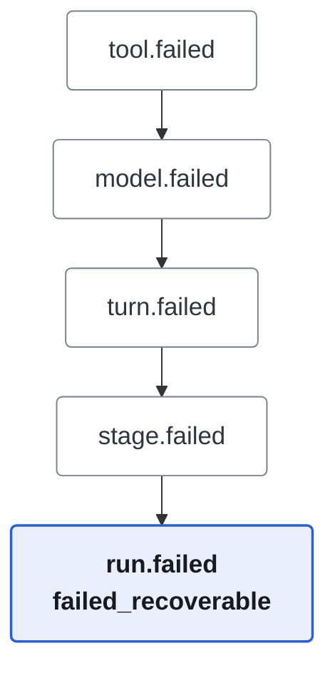
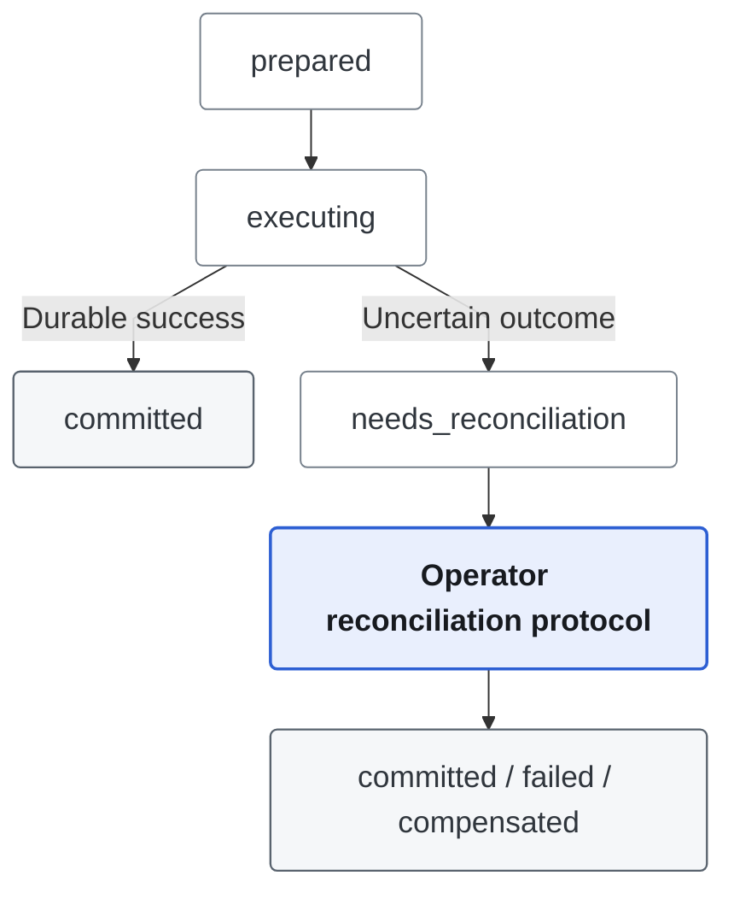

# Durable Recovery and Stage Checkpoints

AgentFlow treats process interruption as a protocol-recovery problem, not only
as a Run status update. The implementation has three cooperating parts:

1. cold-start lifecycle repair;
2. durable Stage checkpoints;
3. an idempotency journal for tools with external side effects.

These records use the same Postgres persistence boundary and are visible
through Run Replay. They contain hashes and execution metadata, never API keys.

## Run Lifecycle Writes

Runtime startup, waiting, Resume, Stop and worker settlement use one conditional
transition. Postgres locks the Run's event stream and row, compares the expected
status, then commits the status, timing fields and lifecycle events together.
Failed persistence changes neither; stale or duplicate commands append no facts.
Subscribers and telemetry receive only committed events.

If completion wins, a late Stop leaves `completed` unchanged. If Stop wins,
successful completion or acknowledged cancellation settles `canceling` as
`canceled`. An independent provider failure still settles as `failed`; Stop is
not proof that every concurrent error was cancellation. Ordinary late results
cannot overwrite a failed or canceled Run. Explicit
[reverification](verification.md) may reconsider the original failed candidate;
this is separate from worker completion.

## Cold-Start Lifecycle Repair

At startup, `recovery.MarkStaleRunningRuns` scans only Runs whose status is
`running` and whose heartbeat is older than `RECOVERY_STALE_RUN_TIMEOUT`.
Active Runs owned by the current process are not scanned.

For each stale Run, the event protocol finds open scopes and appends synthetic
terminal events in inner-to-outer order:



Every synthetic payload includes:

```json
{
  "synthetic": true,
  "reason": "worker_interrupted",
  "repaired_from_event_id": "..."
}
```

The typed `run.failed` payload records `failed_recoverable`, keeping the event
projection aligned with the authoritative Run row. The store rechecks the stale
heartbeat and expected event cursor before making changes. Appending terminal
events, changing running Stage records to `failed`, and changing the Run to
`failed_recoverable` occur in one Postgres transaction. A second startup scan
observes a non-running Run and does nothing, so repair is idempotent.

Recovery planning or persistence failure prevents API startup. It does not
silently leave an inconsistent Run active.

Historical event streams created before strict Stage pairing may contain a
terminal Stage event without a start event. They remain readable. New streams
that contain checkpoint events use strict Stage start/terminal validation.
Streams that predate typed Run lifecycle events are repaired without inventing
an orphan `run.failed` event.

## Stage Checkpoint Protocol

`checkpoint.InternalProvider` records one mutable checkpoint per
`run_id + stage_id`. Its immutable identity contains:

- input hash;
- Runtime Snapshot hash;
- frozen Tool definition hash;
- provider name (`internal_state_v1`).

Its progress fields contain output hash, event cursor, error, and status:

| Status | Meaning |
| --- | --- |
| `prepared` | Internal state was recorded before `stage.started`. |
| `executing` | `stage.started` is durable and work may be in flight. |
| `committed` | `stage.completed` and its output hash are durable. |
| `needs_reconciliation` | The Stage ended or was interrupted without a safe commit. |
| `compensated` | Incomplete internal Stage state was explicitly abandoned during Resume. |

Stage start writes `prepared`, persists `stage.started`, then advances to
`executing`. Stage completion persists `stage.completed` before advancing to
`committed`. A crash between these writes therefore leaves a conservative,
detectable state; Resume never assumes an uncertain Stage committed.

Missing, changed or unavailable frozen Tool definitions reject Continue/Resume
with `runtime_snapshot_unavailable` as a conflict, including SSE error payloads.
The pre-execution rejection preserves the waiting/recovery point. MCP definition
hashes also bind the negotiated protocol and remote input/output schemas; see
[trusted MCP recovery](../tools/mcp-adapter.md#execution-and-recovery).

Resume first validates the complete checkpoint/effect set without writes,
including Runtime Snapshot and Tool definition hashes. A mismatch fails closed
without changing checkpoints or appending restore/compensation facts. Only after
the Run's conditional Resume succeeds does it revalidate and apply restoration;
a persistence failure after acceptance is an execution failure, not preflight
rejection. A committed Stage emits
`checkpoint.restored` and is not rerun. An interrupted Stage with no uncertain
or committed external effect is marked `compensated`. An uncertain effect blocks
Resume with a reconciliation error. A committed external effect in an unfinished
Stage also blocks automatic Resume: recreating that Stage with a new ID cannot
reuse its original journal slots and may repeat an external write. Confirming a
write does not prove the Stage completed. The operator must resolve that boundary;
there is no automatic per-round recovery or Stage-completion override API.
Replay disables Resume and exposes the committed effect as evidence, rather than
mislabeling it as uncertain. Checkpoint refusals retain the recoverable Run state;
the Resume error uses conflict (409), including the error payload after SSE starts.

Resume compatibility is intentionally bounded to the current Runtime Snapshot
schema and its immediately preceding version. Older Runs
remain readable through Replay, but attempting to Resume them returns
`runtime_snapshot_resume_unsupported`. This prevents old execution protocols
from silently inheriting current model, Tool, context, or budget behavior.

## Tool Side-Effect Idempotency

Tool security defaults to `SideEffect=none`, with no journal. A Binding declares
one authoritative security class: `internal_write` derives an internal journal,
while `external_write` and `destructive` derive an external journal. Internal
writes and external writes require Run, a real Turn or Stage, and
Tool Call identity plus a durable Tool Effect Journal.
It derives a stable idempotency key when the caller does not provide one.

The journal uses these states:



Callback claims and exact legal transitions are in the
[reconciliation state model](../tools/tool-side-effect-reconciliation.md#state-model).

Confirmed pre-publication filesystem failures settle directly as `failed`;
only that durable settlement permits model argument correction. Timeouts and
uncertain publication remain fail-closed. [Managed report writes](../tools/scoped-filesystem-writes.md)
retain hash/identity evidence in the existing result column before publication;
claims and unsuccessful reconciliation preserve it until terminal settlement.

- A new key enters `executing` before handler invocation.
- A successful bounded result is stored as `committed`.
- Repeating a committed request returns the stored result with `replayed=true`
  and does not invoke the handler.
- An existing `executing` or `needs_reconciliation` request fails closed; it is
  never retried as if nothing happened.
- Timeout, cancellation, panic, result-encoding failure, or loss of the journal
  commit marks the effect `needs_reconciliation` because an external write may
  already have occurred.
- Stale-Run repair atomically moves abandoned `executing` effects to the same
  state, making process-crash uncertainty visible to operators.
- Operator reconciliation uses optimistic versions and idempotent command IDs.
  Manual confirmation, Tool-specific retry, and Tool-specific compensation
  atomically update the effect with a typed audit event. Retry and compensation
  remain unavailable unless the frozen definition and current Binding both
  declare the matching capability.

Replay exposes Tool Effect status, request hash, and `has_result`, but not the
stored result body. Tool result content remains governed by existing Tool trace
and result-size policy.
See [Tool side-effect reconciliation](../tools/tool-side-effect-reconciliation.md)
for the operator API and complete transition rules.

## Recovery Summary and Actions

Run Replay derives an optional `recovery_summary` from the existing Run,
TaskState, Verification Evidence, Stage checkpoints, and Tool Effect records.
It is a read model, not a persisted recovery state or a replacement
for those source records. Healthy queued, running, and completed Runs omit it.

The summary contains one current reason, bounded supporting evidence, partial
output references, and actions with explicit availability. Multi-Agent Resume
reuses completed Stages and reruns only the first interrupted boundary. Failed
and canceled Runs do not expose Resume. Missing Verification Evidence is
reported as the reason that its review action is unavailable.

An unresolved `needs_reconciliation` or `reconciling` Tool Effect takes
precedence over Resume. The Replay UI exposes the existing operator
reconciliation commands, and `POST /api/runs/{id}/resume` independently rejects
the request with `409` until every uncertain effect is settled. A repeated or
stale Resume also returns `409`; Tool reconciliation retains its existing
optimistic version and idempotent command contracts.

Workspace ownership and operator permissions are checked independently of the
recovery decision. The reconciliation `actor` remains audit attribution, not
proof of identity.

Resume selects its continuation from persisted mode and clarification state,
then rechecks after acquiring the Conversation writer. An answered clarification
uses its bound continuation; an applied receipt on a recoverable Run reuses that
same recovery path. Unanswered or expired questions cannot be bypassed. Replay
and Workbench wait for a successful clarification read before enabling recovery;
a failed read is not an empty result.

Typed pre-execution rejection preserves the recovery point. After execution is
accepted, model, Tool or persistence errors still require settlement. Error text
does not decide whether a Run failed.

## Shutdown Ordering

`RunController.CloseAndWait` rejects new reservations and waits for all accepted
reservations to complete or cancel. Application shutdown drains accepted Runs
and Memory Provider synchronization before closing persistence. If either
drain times out, the Store is not closed underneath active work and shutdown
returns an error.

## Current Boundary

- Postgres implements the repair, checkpoint, and Tool Effect
  contracts.
- Ordinary `failed_recoverable` Resume supports Multi-Agent and Autonomous Runs
  at their existing durable Stage boundaries. Single resumes only a bound
  clarification continuation; it does not restart an arbitrary interrupted Turn.
  Multi-Agent plan approval continues through Continue, not ordinary Resume.
- The checkpoint provider captures AgentFlow internal state. Business-specific
  external compensation handlers are not implemented.
- Multi-instance Worker takeover still requires Lease/Heartbeat/Fencing or a
  Postgres ownership lock. This implementation provides single-process durable
  recovery, not distributed exactly-once execution.
