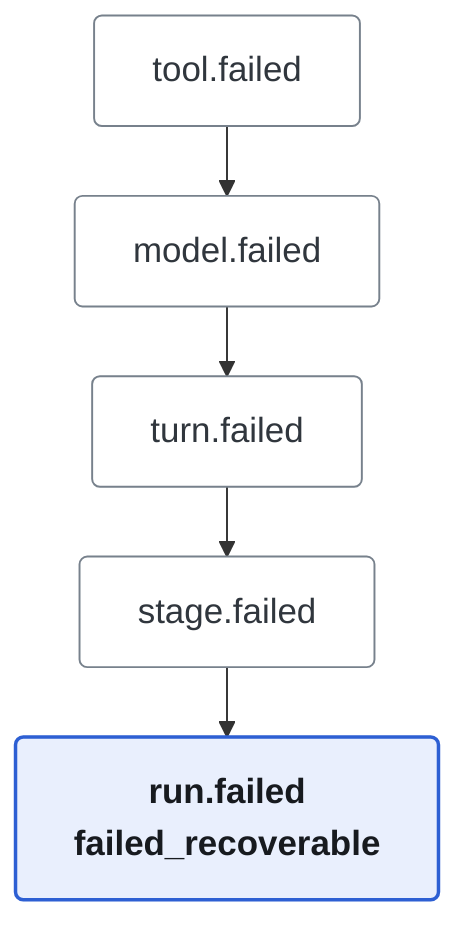

# Durable Recovery and Stage Checkpoints

Recovery combines cold-start lifecycle repair, Stage checkpoints and Tool Effect
receipts in Postgres. Replay exposes their hashes and execution metadata, never
API keys. Browser disconnect is not a crash; [Run continuity](execution-modes.md#client-disconnects-and-run-continuity)
keeps admitted work running.

## Run Lifecycle Writes

Runtime startup, waiting, Resume, Stop and worker settlement use one conditional
transition. Postgres locks the Run's event stream and row, compares the expected
status, then commits the status, timing fields and lifecycle events together.
Failed persistence changes neither; stale or duplicate commands append no facts.
Subscribers and telemetry receive only committed events.

If completion wins, a late Stop leaves `completed` unchanged. If Stop wins,
successful completion or acknowledged cancellation settles `canceling` as
`canceled`. An independent provider failure still settles as `failed`; Stop is
not proof that every concurrent error was cancellation. Ordinary late results
cannot overwrite a failed or canceled Run. Explicit
[reverification](verification.md) may reconsider the original failed candidate;
this is separate from worker completion.

## Cold-Start Lifecycle Repair

Before accepting requests, recovery captures the existing `running` and
`canceling` Run IDs. Stale executions are repaired immediately; one bounded
recheck after `RECOVERY_STALE_RUN_TIMEOUT` covers fresh orphans from a quick
restart. Its heartbeat cutoff never advances beyond startup, so new Runs and
renewed executions cannot be repaired by a late timer. Shutdown cancels and
drains this recheck before closing persistence. This is single-instance crash
repair, not distributed worker ownership or fencing.

Status or event-cursor conflicts reject the stale plan without mutation; the
expiry recheck re-reads at most once to settle a concurrently requested Stop.

For each stale Run, the event protocol finds open scopes and appends synthetic
terminal events in inner-to-outer order:



Every synthetic payload includes:

```json
{
  "synthetic": true,
  "reason": "worker_interrupted",
  "repaired_from_event_id": "..."
}
```

The typed `run.failed` payload records `failed_recoverable`, keeping the event
projection aligned with the authoritative Run row. The store rechecks the expected
Run status, stale heartbeat and event cursor before making changes. Appending terminal
events, changing running Stage records to `failed`, and changing the Run to
`failed_recoverable` occur in one Postgres transaction. Interrupted `canceling`
Runs instead settle as `canceled` with `run.canceled`; uncertain external Effects
still require reconciliation and are never automatically executed. Repeated
repair observes a settled Run and appends no further facts.

Initial planning or persistence failure prevents startup. A failed deferred
recheck is logged and reported on Close; it is not an unbounded background retry.

Historical event streams created before strict Stage pairing may contain a
terminal Stage event without a start event. They remain readable. New streams
that contain checkpoint events use strict Stage start/terminal validation.
Streams that predate typed Run lifecycle events are repaired without inventing
an orphan `run.failed` event.

## Stage Checkpoint Protocol

`checkpoint.InternalProvider` records one mutable checkpoint per
`run_id + stage_id`. Its immutable identity contains:

- input hash;
- Runtime Snapshot hash;
- frozen Tool definition hash;
- provider name (`internal_state_v1`).

Its progress fields contain output hash, event cursor, error, and status:

| Status | Meaning |
| --- | --- |
| `prepared` | Internal state was recorded before `stage.started`. |
| `executing` | `stage.started` is durable and work may be in flight. |
| `committed` | `stage.completed` and its output hash are durable. |
| `needs_reconciliation` | The Stage ended or was interrupted without a safe commit. |
| `compensated` | Incomplete internal Stage state was explicitly abandoned during Resume. |

Stage start writes `prepared`, persists `stage.started`, then advances to
`executing`. Stage completion persists `stage.completed` before advancing to
`committed`. A crash between these writes therefore leaves a conservative,
detectable state; Resume never assumes an uncertain Stage committed.

Normal and resumed execution share Stage settlement. Persistence failures are
returned alongside the execution error; cancellation still records a terminal
checkpoint, while clarification and Tool-approval waits leave the Stage open.

Missing, changed or unavailable frozen Tool definitions reject Continue/Resume
with `runtime_snapshot_unavailable` as a conflict, including SSE error payloads.
The pre-execution rejection preserves the waiting/recovery point. MCP definition
hashes also bind the negotiated protocol and remote input/output schemas; see
[trusted MCP recovery](../tools/mcp-adapter.md#execution-and-recovery).

Resume first validates the complete checkpoint/effect set without writes,
including Runtime Snapshot and Tool definition hashes. A mismatch fails closed
without changing checkpoints or appending restore/compensation facts. Only after
the Run's conditional Resume succeeds does it revalidate and apply restoration;
a persistence failure after acceptance is an execution failure, not preflight
rejection. A committed Stage emits
`checkpoint.restored` and is not rerun. An interrupted Stage with no uncertain
or committed external effect is marked `compensated`. An uncertain effect blocks
Resume with a reconciliation error. A committed external effect in an unfinished
Stage also blocks automatic Resume: recreating that Stage with a new ID cannot
reuse its original journal slots and may repeat an external write. Confirming a
write does not prove the Stage completed. The operator must resolve that boundary;
there is no automatic per-round recovery or Stage-completion override API.
Replay disables Resume and exposes the committed effect as evidence, rather than
mislabeling it as uncertain. Checkpoint refusals retain the recoverable Run state;
the Resume error uses conflict (409), including the error payload after SSE starts.

Only the current Runtime Snapshot schema is resumable. Older Runs remain
Replay-only and return `runtime_snapshot_resume_unsupported` on Resume; they
never inherit live model, Tool, Context or budget settings. See
[Snapshot compatibility](../architecture/terms.md#runtime-snapshot).

## Tool Side-Effect Idempotency

`Descriptor.Security.SideEffect` determines journal use; writes require Run and
Tool Call IDs plus a real Turn or Stage ID. A committed receipt replays without
invoking the Handler. An abandoned `executing` effect becomes
`needs_reconciliation` during stale-Run repair and blocks unsafe Resume.

Confirmed pre-publication failures may settle as `failed`; cancellation, timeout
or uncertain publication must not be treated as proof that no write occurred.
The [reconciliation contract](../tools/tool-side-effect-reconciliation.md) owns
states, idempotent operator commands, supported retry/compensation and result
visibility. [Managed report writes](../tools/scoped-filesystem-writes.md) owns
publication evidence and permitted argument correction.

## Recovery Summary and Actions

Run Replay derives an optional `recovery_summary` from the existing Run,
TaskState, Verification Evidence, Stage checkpoints, and Tool Effect records.
It is a read model, not a persisted recovery state or a replacement
for those source records. Healthy queued, running, and completed Runs omit it.

The summary contains one current reason, bounded supporting evidence, partial
output references, and actions with explicit availability. Multi-Agent Resume
reuses completed Stages and reruns only the first interrupted boundary. Failed
and canceled Runs do not expose Resume. Missing Verification Evidence is
reported as the reason that its review action is unavailable.

An unresolved `needs_reconciliation` or `reconciling` Tool Effect takes
precedence over Resume. The Replay UI exposes the existing operator
reconciliation commands, and `POST /api/runs/{id}/resume` independently rejects
the request with `409` until every uncertain effect is settled. A repeated or
stale Resume also returns `409`; Tool reconciliation retains its existing
optimistic version and idempotent command contracts.

Workspace ownership and operator permissions are checked independently of the
recovery decision. The reconciliation `actor` remains audit attribution, not
proof of identity.

Resume selects its continuation from persisted mode and clarification state,
then rechecks after acquiring the Conversation writer. An answered clarification
uses its bound continuation; an applied receipt on a recoverable Run reuses that
same recovery path. Unanswered or expired questions cannot be bypassed. Replay
and Workbench wait for a successful clarification read before enabling recovery;
a failed read is not an empty result.

Typed pre-execution rejection preserves the recovery point. After execution is
accepted, model, Tool or persistence errors still require settlement. Error text
does not decide whether a Run failed.

## Shutdown Ordering

`RunController.CloseAndWait` rejects new reservations and waits for all accepted
reservations to complete or cancel. Application shutdown drains accepted Runs
and Memory Provider synchronization before closing persistence. If either
drain times out, the Store is not closed underneath active work and shutdown
returns an error.

## Current Boundary

- Postgres implements the repair, checkpoint, and Tool Effect
  contracts.
- Ordinary `failed_recoverable` Resume supports Multi-Agent and Autonomous Runs
  at their existing durable Stage boundaries. Single resumes only a bound
  clarification continuation; it does not restart an arbitrary interrupted Turn.
  Multi-Agent plan approval continues through Continue, not ordinary Resume.
  Continue and Resume share Worker/Reviewer/Finalizer inputs and ordering.
  Resume uses the persisted selected Worker and typed selection reason; older
  records without that evidence omit the reason rather than rerouting.
- The checkpoint provider captures AgentFlow internal state. Explicit
  [report-file compensation](../tools/file-undo.md) is separate; arbitrary
  external API/database compensation handlers are not implemented.
- Multi-instance Worker takeover still requires Lease/Heartbeat/Fencing or a
  Postgres ownership lock. This implementation provides single-process durable
  recovery, not distributed exactly-once execution.
