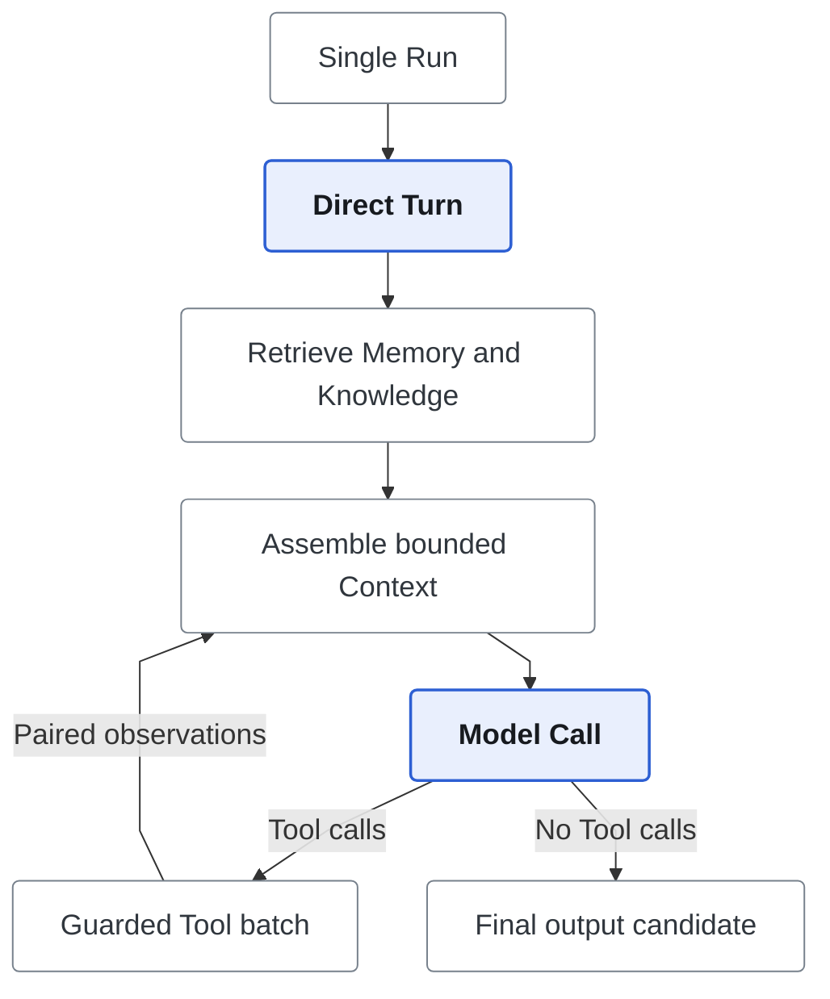
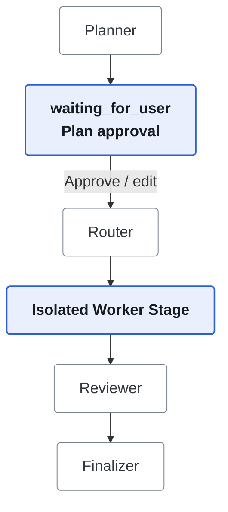
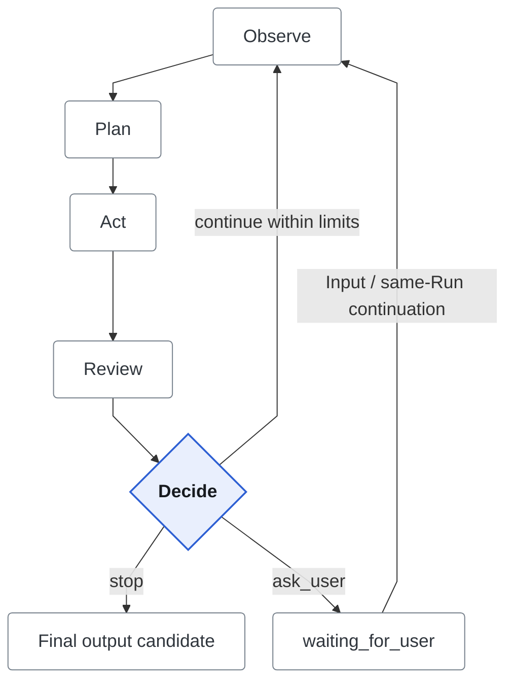

# Execution Modes

AgentFlow supports three orchestration modes over one runtime: **Single**,
**Multi**, and **Loop**. The API values remain `single`, `multi_agent`, and
`autonomous`; the UI uses Direct, Coordinate, and Bounded loop as supporting
labels.

Mode and continuation protocol freeze in the Run Snapshot. All modes use the
same Turn Engine, scoped retrieval, Tool Executor, accounting and completion path.

## Comparison

| Dimension | Single | Multi | Loop |
| --- | --- | --- | --- |
| Primary use | Focused request handled by one Agent | Planned work with specialist routing and review | Open-ended work requiring iterative progress |
| API `mode` | `single` | `multi_agent` | `autonomous` |
| UI label | Direct / Single agent | Coordinate / Multi-agent | Autonomous / Bounded loop |
| Topology | One direct Turn | Fixed collaboration Stages | Repeated Iterations of fixed Stages |
| Human checkpoint | Optional structured clarification | Required plan approval; optional Planner clarification | Optional Act clarification or Decide missing-input question |
| Agent selection | One requested/default Agent | Candidate Agents are frozen; Router selects the Worker | One requested/default Agent performs the loop Stages |
| Completion | Direct candidate output | Finalizer candidate output | Decide final answer or bounded fallback output |

Start with Single. Choose Multi for plan approval, specialist routing or independent
review; choose Loop for repeated observe/act/review decisions. Extra orchestration
adds calls, latency and state, not an automatic quality improvement.

## Single Mode

Single mode handles one request with one selected Agent and one direct Turn.
There are normally no orchestration Stages. A [structured clarification](structured-clarification.md)
closes the paused Turn and resumes the same Run in a new Turn with its saved model/Tool protocol.

Single streams answer chunks immediately. A round that later chooses Tools retracts
provisional commentary with `model.delta.reset`; only the final answer becomes an
assistant Message. Uninterrupted Model/Tool rounds remain one Turn. See the
[bounded Tool loop](../tools/bounded-tool-loop.md) for continuation and stopping rules.

Completed Multi/Loop answers and recovered results use one `model.delta`, without
simulated typing. That delivery is not provider token streaming.

## Client Disconnects and Run Continuity

After admission, the Run owns its execution context. Closing or refreshing the
browser ends only that SSE observation; it does not cancel model or Tool work.
An explicit `POST /api/runs/{id}/cancel` remains the cancellation boundary.

The workbench reconnects through `GET /api/runs/{id}/events`: canonical Projection,
durable events after the requested sequence, then live events. Raw `model.delta`
is live-only; [partial-output checkpoints](durable-partial-output.md) restore
committed answer/reasoning prefixes. The persisted Message remains the final answer.

This continuity is process-local: an API process crash still uses the durable
checkpoint and Resume protocol described in [Durable recovery](durable-recovery.md).

## Multi Mode

Multi mode implements a fixed, inspectable plan-and-review workflow:

1. **Planner** creates an explicit plan and success criteria.
2. The Run enters `waiting_for_user`; the user may approve or edit the plan.
3. **Router** first excludes frozen candidates with invalid identity or
   unavailable Tools, then scores only eligible Agents. Auto routing uses the
   model when available and falls back to deterministic declarative profile matching
   only for transient provider or invalid-response failures. Terminal Auth,
   Budget, cancellation, and configuration failures are not hidden.
4. **Worker** executes the approved plan in an isolated Stage using the selected
   frozen Agent profile and Tool allowlist.
5. **Reviewer** evaluates the Worker result against the task and plan.
6. **Finalizer** synthesizes the candidate final output.

Each responsibility is a Stage. Its persisted record is a
`CollaborationStep`, and its lifecycle emits typed `stage.*` Run Events. Replay
therefore shows the approved plan, routing reason and candidate scores, selected
Worker, review, final answer, and per-Stage latency.

The current topology is intentionally fixed rather than a generic arbitrary
DAG; lifecycle, Continue, and Replay remain predictable. See
[Agent selection](agent-selection.md) for eligibility, ranking/fallback,
Snapshot, and decision-event contracts.

### Isolated Worker Stage

The Worker receives only the approved task, Router-selected frozen Agent,
its frozen Tool allowlist, explicit clarified user input, and retrieved Memory/Knowledge.
It does not inherit the parent clarification Tool or an independent waiting state.
Conversation history, Compaction, Task State injection, and the
`update_task_state` Tool are excluded. It uses the owning Run's routes,
Budget/Ledger, Tool Effects, Artifacts, events, and checkpoints: no Child Run or
second lifecycle authority.

The full output persists on the Worker `CollaborationStep`. Reviewer/Finalizer
receive at most 4,000 characters; truncated handoffs include
`run://<run_id>/stages/<stage_id>` for the full output.
Recovery reuses completed Stages and reruns the first missing/interrupted one,
refusing Resume while effects require reconciliation. See [checkpoints](durable-recovery.md).

### Legacy Worker Data

Legacy Child execution evidence belongs to the owning Worker Stage after upgrade.
Legacy in-flight tasks remain replayable but require a new Run; current Runs
recover through Stage checkpoints, not a Parent/Child lifecycle.

## Loop Mode

Loop mode is the bounded iterative path. It repeats one five-Stage Iteration:

- **Observe** summarizes current state, constraints, risks, and missing facts.
- **Plan** chooses the next concrete action for this Iteration.
- **Act** uses the same bounded Tool loop as Single and Multi Worker, with the
  Run's frozen Agent and Tool allowlist. Other iteration Stages cannot call Tools.
- **Review** checks progress and remaining gaps.
- **Decide** returns `continue`, `stop`, or `ask_user` with a reason and optional
  final answer.

Every Stage carries an Iteration number. `run.progress` exposes current
iteration, elapsed active runtime, output characters, Tool usage, effective
limits, and stop reason.

Iterations and accumulated output are Loop-owned limits. Runtime, Tool calls,
model calls, tokens and cost use the effective [Run Budget](run-budget.md);
operation timeouts, cancellation and Conversation single-writer ownership also apply.

When Decide requests information, the Run persists a human-input checkpoint
and enters `waiting_for_user`. Resume continues the same Run from its frozen
Runtime Snapshot and saved Steps. Startup recovery can mark a stale running Run
`failed_recoverable`; the recovery path resumes from persisted loop state.

Loop is not an unbounded background scheduler. The current implementation is a
bounded in-process execution protocol. The Tool Progress Guard handles repeated
typed failures, unchanged read results, and bounded Tool-call oscillation;
distributed scheduling and semantic goal-progress assessment remain outside the
implemented boundary.

For entity semantics, see [Internal terms](../architecture/terms.md). For limits and ownership,
see [Execution controls](execution-controls.md). For package boundaries, see
[Backend architecture](../architecture/backend-architecture.md).
