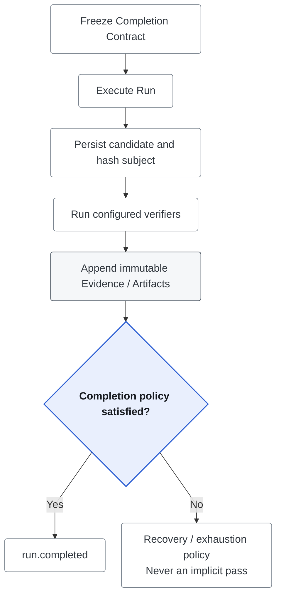

# Verification

An optional **Completion Contract** treats generated output as a candidate until
configured checks pass. It is frozen when the Run starts and applies to Single,
Multi and Loop through the same completion path. Ordinary Chat remains
`verification_status=not_required`.



## Verification vs. Tests

| Mechanism | Question | Effect |
| --- | --- | --- |
| Runtime Verification | Does this candidate satisfy this Run's contract? | Can gate `run.completed` |
| Automated/manual tests | Does the implementation behave as specified? | Development/release evidence |
| Offline evaluation | How does a versioned task set perform? | Regression/comparison report, not online policy |

These are distinct from execution success and subjective truth. A schema-valid
answer can still be wrong. See [evaluation](../evaluation/README.md) and
[structured output](structured-output.md) for separate generation constraints
and evidence-backed machine results.

## When Verification Runs

Only a valid initial `POST /api/chat` `completion_contract` enables Verification.
Environment allowlists configure execution, not opt-in. The workbench exposes
the contract under **Verification**; disabling it omits the field.

- Contracted Runs start `pending`; intermediate human waits do not claim completion.
- Continue/Resume inherit the frozen contract and cannot replace or weaken it.
- `POST /api/runs/{id}/verify` uses another bounded attempt on the persisted
  candidate; ordinary uncontracted Runs return `409`.
- Terminal SSE reports verification status separately from Run status.
- Run/Evidence/Artifact access preserves current authorized Workspace scope;
  foreign IDs return `404`. See [resource authorization](../operations/resource-authorization.md).

## Execution Model

| Verifier | What it establishes | What it does not establish |
| --- | --- | --- |
| `command` | Exit/output of an allowlisted argument vector, no shell | Safe arbitrary host-code execution |
| `http` | Read-only GET/HEAD status/body checks | Absence of remote side effects |
| `json_schema` | JSON Schema 2020-12 validation | Provider-constrained generation or factual truth |
| `text_constraints` | Bounds, phrases and headings | Semantic correctness |
| `citation` | Explicit external-link/host policy | Source reachability or claim support |
| `answer_relevance` | Question/answer embedding similarity | Groundedness or correctness |
| `grounded_answer` | Selected-source markers and deterministic claim support | General entailment or source quality |

Evidence is append-only and binds contract/verifier versions, Snapshot hash,
candidate Subject Hash, attempt, status, duration, diagnostics and Artifacts.
Question-aware checks also hash the question; grounding binds source content.
Changed candidates append stale markers rather than rewriting earlier Evidence.

Reverify resolves the Run-local candidate through its last durable
`citation.resolved.message_id`, never the latest Conversation answer or question.
For contracted Runs, the RAG citation event also stores `verification_question`
(the exact completion input, including resolved clarification text) and
`verification_subject_hash` (a SHA-256 binding of Run/message identity, that input
and candidate bytes, separate from the verifier's normalized/grounded Subject
Hash). This binding must persist before the first verification attempt; a write
failure is returned.

All contracts check that binding and current-candidate Evidence against the
reconstructed subject. Contract, verifier-version and Snapshot checks also apply
to historical Evidence. Planning Runs additionally
require intact plan evidence with the same input/proposal. Later Conversation
messages do not prevent fresh checks on the original candidate, and a failed first
Evidence write does not strand a durably bound candidate. Reverify does not resave
the answer or replace structured-output evidence with a later answer.
Only a passing gate uses explicit verified completion; ordinary worker completion
cannot reopen a Run that has already failed.

Run-local revisions supersede earlier candidate bindings; stale markers for older
subjects are not evidence for the current candidate. Verification event sequences
identify the candidate epoch; when a best-effort verification event is absent,
Evidence start time is compared with the binding event's timestamp. A revision
with only historical/stale results can retry without resetting the attempt budget.
Missing, conflicting or
changed current pointers/bindings return `409` without an attempt;
storage failures are errors, not empty success. Legacy events without the exact
question/binding also return `409`: history timestamps cannot reliably reconstruct
Resume or clarified input. This change adds event payload fields, not DB columns.

HTTP Reverify uses the same capacity and Conversation admission as execution and
Resume, holds it through verification/settlement, and reloads the Run after waiting.
A concurrent Resume therefore cannot replace the candidate during verification.
This uses the existing in-process controller, not a distributed locking protocol.

## Policy Semantics

- `required=true` participates in the gate; optional checks still produce Evidence.
- `all_must_pass` requires every required check; `any_may_pass` requires at least one.
- `max_attempts` is 1-5, independent of provider retries.
- Failed/blocked checks remain recoverable while attempts remain. Exhaustion
  follows `on_exhausted=fail` or `waiting_for_user`.
- Unavailable checks are `blocked`, never implicitly passed. Stable
  `details.reason_code`, not summary parsing, identifies the reason.

## Contract Example

Include this with the selected Agent and authorized scope in `POST /api/chat`:

```json
{
  "message": "Report the incident code AUTH-7F31.",
  "completion_contract": {
    "subject_type": "run_output",
    "verifiers": [{
      "id": "incident-code",
      "type": "text_constraints",
      "required": true,
      "config": {"required_phrases": ["AUTH-7F31"]}
    }],
    "policy": {
      "mode": "all_must_pass",
      "max_attempts": 2,
      "on_exhausted": "waiting_for_user"
    }
  }
}
```

The server assigns omitted identity, normalizes defaults and freezes implementation
versions/hash; request-provided hash/version are not trusted. Each verifier owns
strict config decoding and rejects unknown fields. The example proves only that
the response contains the required phrase.

### Answer Relevance

`answer-relevance-embedding-v1` uses the configured embedding provider. Config
includes `minimum_score` and `minimum_answer_characters`; thresholds are
model-specific and need representative calibration, not a universal default.
It removes verbatim question repetition before embedding the substantive answer.

Evidence retains score, threshold, provider/model/dimensions and repetition handling.
Missing service, local-hash estimates, mixed identities, malformed vectors and
timeouts block the check; there is no lexical fallback. Two embedding calls per
attempt use shared request controls but are not generation-token Usage Ledger entries.

### Grounded Knowledge Answers

Use `grounded_answer`, not the external-link `citation` verifier, for `[S#]` sources:

```json
{
  "id": "grounded-answer",
  "type": "grounded_answer",
  "required": true,
  "config": {
    "minimum_claim_support": 0.5,
    "no_answer_phrases": ["insufficient evidence"]
  }
}
```

`grounded-answer-lexical-v1` splits claims and checks coverage plus exact numeric,
code and named anchors in cited selected Context. It records unsupported claims,
scores, IDs and missing anchors, not duplicate source text. Tool-only evidence is
the immutable read content actually selected, not unread current source bytes.

No selected source permits only a configured insufficient-evidence phrase without
factual claims. With selected sources, pure refusal fails; partial supported
answers may explicitly mark missing evidence. Deleted/version-drifted/missing
sources block the check. The `0.5` fixture baseline is not semantic entailment or
world truth; calibrate on domain answers before enforcing quality claims.

### External Citations

`citation` counts unique explicit Markdown links/CommonMark autolinks; images,
relative links and bare URL-like text do not count. Host rules include subdomains.
It does not fetch or validate support. [Web citations](../tools/web-source-citations.md)
and Knowledge aliases are separate source protocols.

## Security Boundaries

[Execution boundaries](../operations/execution-boundaries.md) owns executable,
destination and response-limit rules. Host command verification requires trusted
local mode, a configured root and absolute executable allowlist; OIDC cannot use
it. Root/environment/process-group controls are **not an OS sandbox**. An
allowlisted executable still has server-user authority; isolated sandbox Tool
execution is a different capability.

HTTP origins default to deny, including loopback. Grant exact trusted origins;
DNS validation pins the dialed IP, redirects/proxies are disabled, and metadata
destinations remain blocked. GET alone does not guarantee harmless remote behavior.
Timeout/oversize responses block verification even if the status matches.
Artifact count/byte caps and redaction still apply. Reverify/Resume use current
operator grants, never an old implicit authorization.

## Replay and Events

Replay returns `verification_evidence` and `verification_artifacts`; Episode adds
a summary. [Typed events](event-catalog.md) expose requested/started/pass/fail/
blocked/stale and revision transitions. Durable records use idempotent Postgres
startup migration, not a separate verification database.

## Extension Model

A registry implementation owns stable type/version, normalized config and status/
details/Artifacts. Register it before serving; adding a synchronous verifier does
not change contract hashing, gate policy or persistence. Thresholds belong inside
the verifier; the gate consumes passed/failed/blocked and required-check policy.

Built-in model graders and asynchronous human Evidence ingestion are not
implemented. Deterministic structure/relevance checks cannot replace calibrated
human/model assessment of high-impact answers. A command verifier runs a test
runner only when an operator explicitly configures and allowlists it; it never
discovers the repository suite automatically.
